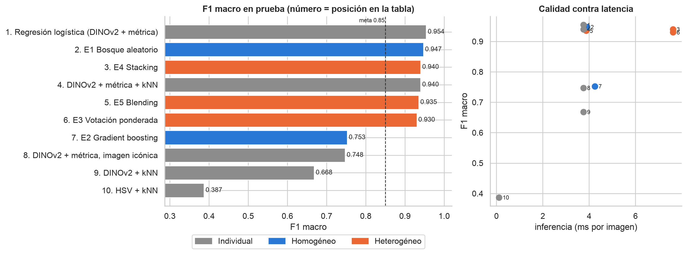
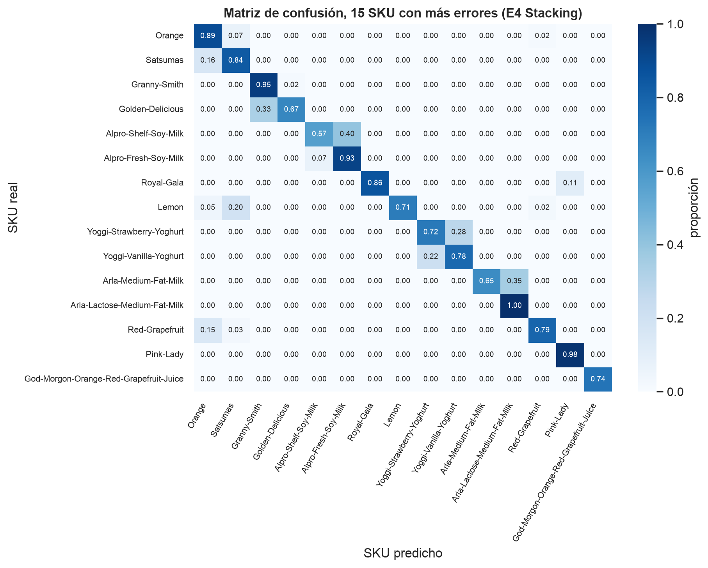
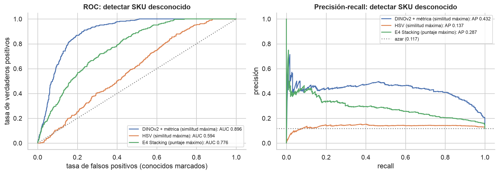

<div style="text-align: center;">

# Avance 5 | Modelo final

### Ensambles para identificar el SKU de cada producto contra una galería de referencia

**Tecnológico de Monterrey** · Maestría en Inteligencia Artificial Aplicada<br>
**TC5035.10 — Proyecto Integrador (Grupo 10)**

**Equipo 48** · **Modalidad:** En equipo · **Fecha:** 1 de noviembre de 2026

| Integrante | Matrícula |
|---|---|
| Oscar Alberto Ramírez Anaya | A01795438 |
| Germán Eduardo Rodríguez Vázquez | A01796325 |
| Jesús Soto Medrano | A01794746 |

**Profesora:** Dra. Grettel Barceló Alonso · **Asesor:** Dr. Raúl Valente Ramírez<br>
**Sponsor:** Dr. Juan Arturo Nolazco Flores · **Organización:** Bnext

</div>

---

**Entregable:** [`Avance5.48.ipynb`](./Avance5.48.ipynb) ·
[Ver en nbviewer](https://nbviewer.org/github/oscar-ramirez-anaya/Avance5_Equipo48/blob/main/Avance5.48.ipynb) ·
[Reporte PDF](./Avance5.48.pdf) · [Reporte DOCX](./Avance5.48.docx)

## Resumen

Fase de **Ingeniería del modelo** de CRISP-ML(Q), cierre. Los mejores modelos individuales del Avance 4 (histograma HSV y DINOv2) y el embedding recomendado en la sesión con Bnext del 28 de octubre (DINOv2 con aprendizaje de métrica) se combinan en **cinco ensambles, homogéneos y heterogéneos**, para identificar el SKU de cada producto contra una galería con una carpeta por SKU. Después se elige el modelo final con criterios de negocio.

> **Datos de esta ejecución.** Durante la ventana de entrega no hubo acceso al servidor ni al Jetson de Bnext, y los datos de Bnext no pueden salir de su infraestructura. Por eso la libreta se ejecutó con el *Grocery Store Dataset* (Klasson et al., 2019; licencia MIT), que tiene la misma estructura de una carpeta por producto. Las cifras validan el método y **no son resultados sobre datos de Bnext**. El mismo código se ejecutará con la galería real.

| Indicador | Resultado (prueba) |
|---|---|
| Aprendizaje de métrica (SupCon) sobre DINOv2 | F1 macro de **0.668 a 0.940** |
| SKU no vistos al entrenar, top-1 | **0.928** (contra 0.935 en vistos) |
| **Modelo final: E4 Stacking** | F1 macro **0.940** · top-1 **0.937** · top-5 **1.000** · MRR **0.966** |
| Mejor F1 absoluto | Regresión logística, 0.954, pero requiere reentrenar al agregar un SKU |
| Meta de negocio (F1 macro ≥ 0.85) | Se cumple |
| Limitación | Detectar SKU desconocidos: AUC 0.776 con el stacking y 0.896 con DINOv2 + métrica; se recomienda un filtro previo |

## Cobertura de la rúbrica

| Criterio | Dónde | Evidencia |
|---|---|---|
| **Ensambles** (60) | Secciones 4 y 5 | 5 ensambles: bosque aleatorio y gradient boosting (homogéneos); votación ponderada, stacking y blending (heterogéneos) sobre los mejores individuales. Optimización con Optuna y rejillas. |
| **Selección** (20) | Sección 6 | Tabla de 10 modelos ordenada por F1 macro, con top-1, top-5, MRR, tiempo de entrenamiento, latencia y si permite alta de SKU sin reentrenar. Elección argumentada con criterios de negocio. |
| **Gráficos** (20) | Secciones 4.1 y 7 | Siete gráficas con interpretación: curvas de aprendizaje de métrica, comparación, matriz de confusión, ROC y precisión-recall, puntajes contra umbral, importancia de las bases y F1 por SKU. |

## Comparación

| # | Modelo | Tipo | F1 macro | Top-1 | Top-5 | Entrenamiento (s) | Alta de SKU |
|---|---|---|---|---|---|---|---|
| 1 | Regresión logística (DINOv2 + métrica) | Individual | 0.954 | 0.953 | 0.999 | 0.1 | Reentrenar |
| 2 | E1 Bosque aleatorio | Homogéneo | 0.947 | 0.945 | 0.999 | 47.2 | Reentrenar |
| **3** | **E4 Stacking (final)** | **Heterogéneo** | **0.940** | **0.937** | **1.000** | **0.1** | **Sin reentrenar** |
| 4 | DINOv2 + métrica + kNN | Individual | 0.940 | 0.934 | 0.998 | 283.9 | Sin reentrenar |
| 5 | E5 Blending | Heterogéneo | 0.935 | 0.931 | 0.998 | 0.0 | Sin reentrenar |
| 6 | E3 Votación ponderada | Heterogéneo | 0.930 | 0.928 | 0.999 | 0.1 | Sin reentrenar |
| 7 | E2 Gradient boosting | Homogéneo | 0.753 | 0.771 | 0.942 | 157.5 | Reentrenar |
| 8 | DINOv2 + métrica, imagen icónica | Individual | 0.748 | 0.751 | 0.974 | 283.9 | Sin reentrenar |
| 9 | DINOv2 + kNN | Individual | 0.668 | 0.701 | 0.948 | 9.9 | Sin reentrenar |
| 10 | HSV + kNN | Individual | 0.387 | 0.418 | 0.804 | 0.3 | Sin reentrenar |



## Hallazgos

1. **El aprendizaje de métrica es la mayor mejora** y generaliza a SKU que no se vieron al entrenar. Esto respalda dar de alta productos agregando su carpeta.
2. **Los errores están en variantes de una misma marca**: leches de soya de anaquel y refrigeradas, leche normal y deslactosada, sabores de yogur. Siguientes pasos: negativos difíciles y modelos que lean texto (CLIP o SigLIP).
3. **La validación cruzada dentro de entrenamiento tiene fuga** porque las fotos se toman en ráfagas: HSV da 0.95 fuera de partición y 0.42 en prueba. Los ensambles se ajustaron con validación, que es de otra sesión.
4. **Productos desconocidos:** el stacking elige bien entre candidatos, pero distingue peor lo que no está en la galería. Se propone filtrar primero con la similitud de DINOv2 + métrica.




## Pendiente para la ejecución con datos de Bnext

- Ejecutar la libreta en el Jetson con la galería de SKU de Bnext.
- Hacer los ensambles del detector (WBF de FCOS y Faster R-CNN, FCOS con TTA).
- Correr el pipeline completo en uno o dos refrigeradores.
- Solicitar a Bnext el planograma esperado.

## Contenido del repositorio

| Archivo | Descripción |
|---|---|
| **`Avance5.48.ipynb`** | Libreta ejecutada de principio a fin, en secuencia, con salidas y gráficos |
| `Avance5.48.pdf` / `Avance5.48.docx` | Reporte del avance |
| `Avance5.48.html` | Fuente del PDF |
| `figuras/` | Gráficas exportadas de la libreta |
| `scripts/construir_avance5.py` | Genera la libreta; las interpretaciones están en `avance5_textos.json` |
| `scripts/generar_documento_avance5.py` | Genera HTML, PDF y DOCX con las figuras de la libreta ejecutada |
| `scripts/verificar_publicacion.py`, `.githooks/` | Verificación previa a cada commit |
| `POLITICA_DATOS.md` | Acuerdo de manejo de datos con Bnext |

## Reproducir

```bash
git clone --depth 1 https://github.com/marcusklasson/GroceryStoreDataset.git ../../datasets_publicos/GroceryStoreDataset
python3 -m venv .venv && .venv/bin/pip install torch torchvision pytorch-metric-learning optuna scikit-learn pandas seaborn opencv-python-headless jupyter
.venv/bin/python scripts/construir_avance5.py
A5_PERFIL=completo .venv/bin/jupyter nbconvert --to notebook --execute --inplace Avance5.48.ipynb
.venv/bin/pip install pymupdf python-docx && .venv/bin/python scripts/generar_documento_avance5.py
```

Para la galería de Bnext se define `A5_DATA_DIR` con la ubicación de los datos dentro de su infraestructura, conforme a [`POLITICA_DATOS.md`](POLITICA_DATOS.md).

## Uso de IA

La declaración de uso de herramientas de IA está al final de la libreta y en el anexo A del reporte.

## Referencias

- Klasson, M., Zhang, C., y Kjellström, H. (2019). A hierarchical grocery store image dataset with visual and semantic labels. En *2019 IEEE Winter Conference on Applications of Computer Vision* (pp. 491–500). IEEE.
- Khosla, P., et al. (2020). Supervised contrastive learning. En *Advances in Neural Information Processing Systems 33*.
- Oquab, M., et al. (2024). DINOv2: Learning robust visual features without supervision. *Transactions on Machine Learning Research*.
- Wolpert, D. H. (1992). Stacked generalization. *Neural Networks, 5*(2), 241–259.
- Visengeriyeva, L., Kammer, A., Bär, I., Kniesz, A., y Plöd, M. (2023). *CRISP-ML(Q). The ML lifecycle process*. MLOps. INNOQ. https://ml-ops.org/content/crisp-ml

La bibliografía completa está en el reporte PDF.
